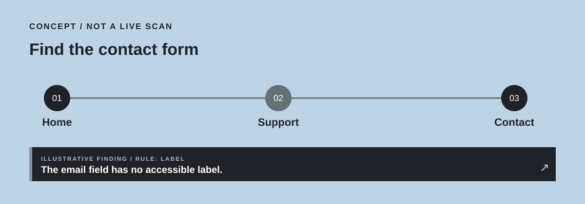
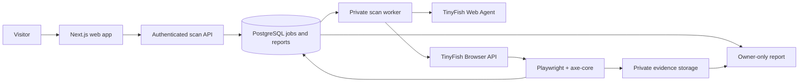

<p align="center">
  
</p>

<h1 align="center">AccessPath</h1>

<p align="center"><strong>Accessibility evidence for the entire journey.</strong></p>

<p align="center">
  Start with what a visitor is trying to do. Follow the route through the live web. Find the barriers that appear along the way.
</p>

<p align="center">
  <a href="#the-idea">The idea</a> ·
  <a href="#current-build">Current build</a> ·
  <a href="#quick-start">Quick start</a> ·
  <a href="#technical-design">Technical design</a> ·
  <a href="#roadmap">Roadmap</a>
</p>

> **Development status:** The designed, responsive landing page and its interactive *illustrative* journey preview are implemented. The production build passes. Live TinyFish navigation, audits, accounts, scan reports, and deployment are still in development. The example findings on the landing page are not real scan results.

## The idea

Most accessibility checks begin with a URL. People begin with a goal: find help, reach a contact form, complete an application, or understand a service. AccessPath is being built around that goal. It will discover the route a visitor takes, check the pages encountered, and connect each technical finding to the point in the journey where it matters.

**Input:** a public HTTPS website and a short visitor task.  
**Output:** a journey timeline, page-level accessibility findings, affected elements, evidence, and items requiring human review.

AccessPath is designed for developers, QA teams, agencies, and teams responsible for public-facing websites. It aims to make accessibility work more actionable. It does **not** claim that an automated scan can certify WCAG conformance; [W3C explains why human evaluation remains necessary](https://www.w3.org/WAI/test-evaluate/).

<p align="center">
  
</p>

## Current build

**Implemented and verified locally**

- Next.js 16 and React 19 web application in a pnpm workspace.
- Responsive AccessPath landing page with a custom five-color visual system.
- Interactive, keyboard-operable journey preview; each example step can be selected.
- Clear labeling of sample content as illustrative.
- Successful `pnpm build` production compilation and prerender.

**Not yet implemented**

- Live journey creation and TinyFish API calls.
- Browser accessibility audits and real report evidence.
- Authentication, database storage, job queue, quotas, and production hosting.

This section will be updated from tested code as milestones land. Planned capabilities below describe the intended product, not features that already work.

## How AccessPath will work

1. **Set a goal.** The user enters a public HTTPS URL and a task such as “find the contact form.”
2. **Discover the journey.** TinyFish Web Agent follows the goal on the live site and returns the route as structured data.
3. **Audit the route.** A bounded browser session checks the relevant pages with axe-core and captures evidence.
4. **Review the result.** AccessPath shows the steps, findings, affected elements, and checks that still need a person.

TinyFish is central to the proposed product: its agent discovers a task-specific route, while its Browser API supplies an isolated browser that can be controlled through Playwright/CDP. [Agent API](https://docs.tinyfish.ai/agent-api/reference) · [Browser API](https://docs.tinyfish.ai/browser-api/reference).

## Quick start

### Requirements

- Node.js 24
- pnpm 12

From the repository root:

```bash
pnpm install
pnpm dev
```

Open **http://localhost:3000** to see the current web app.

Check the production build:

```bash
pnpm build
```

The landing page currently needs no API keys. When the live workflow is added, required environment variable names and setup steps will be documented in `.env.example`; credentials must never be committed.

## Technical design

The following architecture is **planned**. The web app is the only implemented component today.



| Layer | Planned choice | Purpose |
| --- | --- | --- |
| Web | Next.js App Router, React, TypeScript, CSS Modules | Public interface, authenticated short-lived API requests |
| Identity and records | Supabase Auth and PostgreSQL with row-level security | Users, scan jobs, findings, and owner isolation |
| Evidence | Private Supabase Storage | Screenshots available only through authorized access |
| Worker | Node.js service on Railway | Long-running scans outside web requests |
| Live-web navigation | TinyFish Web Agent | Goal-driven journey discovery |
| Browser audit | TinyFish Browser API, Playwright/CDP, axe-core | Isolated page checks and screenshot evidence |

The intended first scan is deliberately bounded: one public task, a small page limit, no target-site login or payment flow, and no form submission. URL validation, redirects, timeouts, quotas, private evidence, and cancellation must be implemented and tested before public scan access is offered. DDoS mitigation and scaling are engineering goals, not current performance claims.

### Repository layout

```text
AccessPath/
├─ apps/web/           Next.js application (implemented)
├─ docs/               Team handoff and future technical documents
├─ demo-site/          Controlled broken/fixed journey (planned)
├─ packages/           Shared contracts (planned)
├─ supabase/           Database migrations and policies (planned)
├─ pnpm-workspace.yaml
└─ README.md
```

## Roadmap

- [x] Establish the TypeScript workspace and production-buildable web app.
- [x] Design the landing page and interactive illustrative journey preview.
- [ ] Publish a controlled, public demo journey with known accessibility issues and a corrected version.
- [ ] Complete and record a real TinyFish Agent and Browser API run.
- [ ] Run axe-core against the discovered pages and capture reproducible evidence.
- [ ] Add authenticated scan submission, a durable worker queue, private reports, and usage limits.
- [ ] Test user isolation, failure states, mobile layout, keyboard access, and production deployment.
- [ ] Add verified screenshots, demo results, and live links to this README.

## Demonstration plan

The judged demonstration will use a small website controlled by the team. The same visitor task will be run against an intentionally flawed version and a corrected version. We will show the actual TinyFish route, raw rule IDs, affected elements, and evidence. Any before/after claim will be based on real scans; the conceptual images in this README are not test results.

## Project documentation

- [AZINHACK team handoff](docs/AccessPath-AZINHACK-2026-Team-Handoff.pdf) — product definition, architecture, presentation brief, demo plan, and source register.
- Architecture, security, deployment, and validation documents will be added as their corresponding features are implemented.

## AZINHACK 2026

AccessPath is being developed for [AZINHACK 2026 at USAR, GGSIPU East Delhi Campus](https://unstop.com/hackathons/azinhack-2026-university-school-of-automation-robotics-usar-guru-gobind-singh-indraprastha-university-ggsipu--1763832), an open innovation hackathon that requires a meaningful TinyFish integration. The project proposal, code, and presentation will be submitted according to the event listing.

## License and contact

The team has not selected a software license or published a project contact address yet. Until a license is added, this repository should not be described as open source. Contact and contribution instructions will be added with the public GitHub repository.
