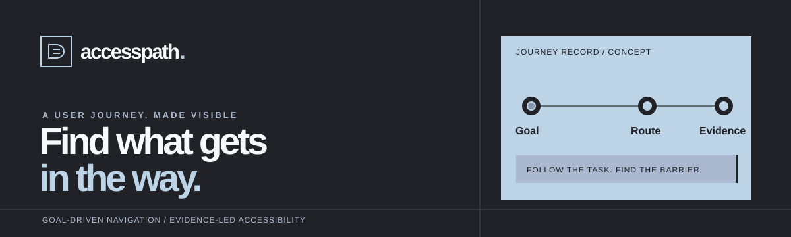
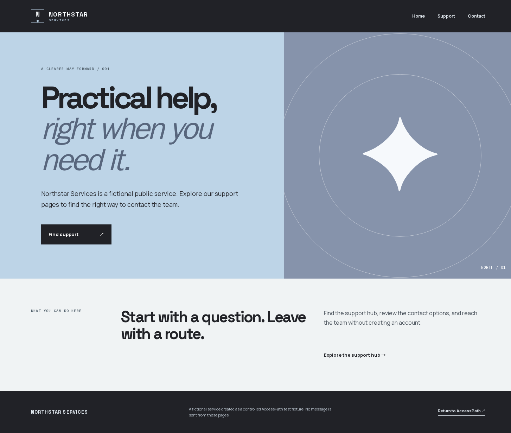
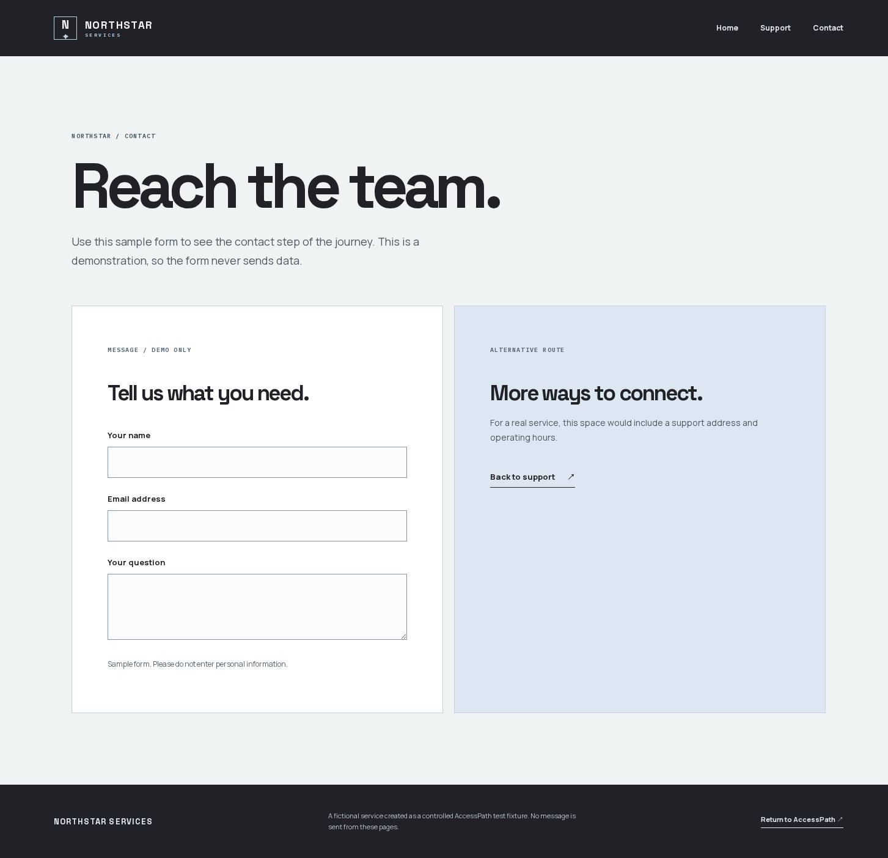

<p align="center">
  
</p>

# AccessPath

**Accessibility evidence for the route a visitor actually takes.**

AccessPath starts with a visitor goal, discovers the route through a live website, and checks the pages along that route. Its report connects each automated finding to the page, affected element, and screenshot. Human review remains necessary; AccessPath does not certify WCAG conformance.

- [Live web app](https://access-path-mu.vercel.app)
- [Controlled Northstar demo](https://access-path-mu.vercel.app/demo-site)
- [Verified demo audit](https://access-path-mu.vercel.app/reports/demo)

## The controlled journey

The screenshots below are from the public Northstar test site used by the working scan. The visitor starts at Home, follows Support, and reaches the Contact form. The live report records the three visited pages and flags the contact page's email field under axe-core's `label` rule.

**Home**



**Contact**



The [verified demo audit](https://access-path-mu.vercel.app/reports/demo) shows the rule and affected element. Signed-in users can also open their own saved live reports from the [dashboard](https://access-path-mu.vercel.app/dashboard).

## Why this matters

A single URL check can miss the context of a task such as finding help or reaching a contact form. AccessPath asks what the visitor is trying to do, follows the route, and makes the resulting accessibility evidence easier to reproduce and act on. The intended users are developers, QA teams, agencies, and teams responsible for public-facing services.

## What works today

- A deployed Northstar Services demo with Home, Support, and Contact pages. Its contact page intentionally contains an unlabeled email field; a corrected page is available for comparison.
- TinyFish Web Agent route discovery for the controlled site.
- A verified audit performed in a TinyFish Browser session with Playwright and axe-core. The [saved demo report](https://access-path-mu.vercel.app/reports/demo) shows the `label` rule finding and screenshots of the original and corrected pages.
- Supabase sign-in and owner-only saved reports, including import of a previously exported audit JSON file.
- An invite-only live scan queue with account and global limits, a paused switch, and a Railway worker. An end-to-end run completed on the approved demo and opened as a saved report. The verified demo report remains available independently.

The live queue currently accepts only `https://access-path-mu.vercel.app/demo-site`. It does not scan arbitrary websites. It permits one active scan per account and a bounded number of paid preview attempts. It does not log in, submit forms, or change a target site.

## Demo in two minutes

1. Open the [controlled demo](https://access-path-mu.vercel.app/demo-site) and follow **Home → Support → Contact**.
2. Open the [verified audit report](https://access-path-mu.vercel.app/reports/demo). Inspect the `label` finding on the contact form and its screenshot.
3. Open the [corrected contact page](https://access-path-mu.vercel.app/demo-site/fixed/contact) to see the associated label.
4. If live scans are enabled for your account, sign in to the [dashboard](https://access-path-mu.vercel.app/dashboard) to view owner-only saved evidence. The live scan button is an invite-only preview and uses TinyFish credits.

## How it works

1. The user enters a visitor goal for the approved site.
2. TinyFish Web Agent discovers the pages visited while pursuing the goal.
3. TinyFish Browser provides an isolated browser. Playwright opens up to three approved pages, runs axe-core, and captures screenshots.
4. The worker saves the journey and report in Supabase. Row Level Security limits report access to the account owner.

Next.js serves the UI and short API requests on Vercel. A separate Node worker on Railway handles browser work outside the web request. The queue is stored in Supabase PostgreSQL and claimed by a restricted worker function.

## Local setup

Requires Node.js 24 and pnpm 12.

```powershell
pnpm install
pnpm --filter ./apps/web build
pnpm dev
```

Open `http://localhost:3000`. The public landing page and local demo do not require keys. For sign-in, put the names from the root `.env.example` in `apps/web/.env.local` using your own Supabase project URL and publishable key. The local environment file is ignored by Git.

The private journey preview and audit routes also need the server-only values described in `apps/web/.env.example`. Keep `TINYFISH_API_KEY` and preview codes out of `NEXT_PUBLIC_*` variables. Never commit credentials or audit exports.

To create your own database, run the migrations in order from `supabase/migrations/` in a fresh Supabase project. The second migration creates the live queue in the **paused** state. The third migration excludes never-started cancelled jobs from paid-scan limits. The fourth allows a second paid diagnostic attempt in one UTC day; it does not enable the queue. Configure the worker separately with `SUPABASE_URL`, a Supabase `sb_secret_` key, `TINYFISH_API_KEY`, and `ACCESSPATH_WORKER_ENABLED=true`. Do not place the secret key in the web app.

## Checks

```powershell
pnpm --filter ./apps/web build
pnpm --filter @accesspath/worker check
pnpm --filter @accesspath/worker test
```

The controlled fixture and the verified audit method are documented in [demo fixture](docs/demo-fixture.md) and [audit validation](docs/demo-audit-validation.md). Those notes distinguish recorded evidence from proposed capabilities.

## Next build stage

The hackathon work will extend the tightly approved demo to safe public HTTPS sites, improve scan recovery and cost controls, store evidence privately, and compare a route before and after a fix. These are planned improvements, not current verified features.

## AZINHACK 2026

AccessPath is an open innovation entry for [AZINHACK 2026](https://unstop.com/o/1763832). TinyFish is central to route discovery and provides the browser used for the accessibility checks. The submitted presentation and this repository describe the implemented prototype and the remaining build work.
